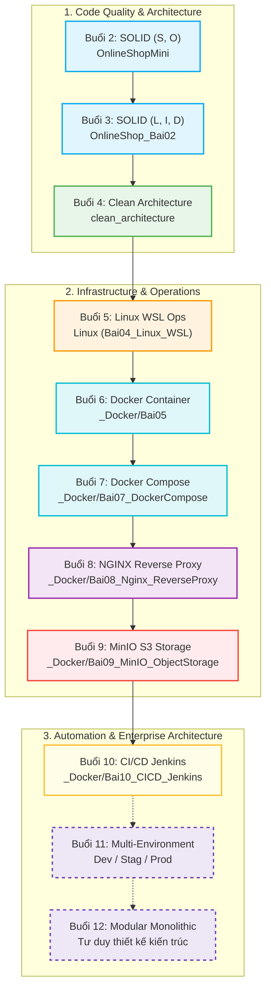

# 🚀 Phát Triển Ứng Dụng Phần Mềm Chuyên Nghiệp (PTUD PMCNC)

> **Kho lưu trữ mã nguồn & tài liệu thực hành toàn diện:** Lộ trình phát triển phần mềm chuẩn doanh nghiệp từ tư duy Thiết kế Hướng đối tượng (SOLID), Kiến trúc sạch (Clean Architecture), Vận hành Linux, Đóng gói Containerization (Docker, Compose), Reverse Proxy (NGINX), Lưu trữ đám mây (MinIO S3), Tự động hóa CI/CD (Jenkins), đến Kiến trúc nguyên khối module hóa (Modular Monolithic).

---

## 🗺️ Bản Đồ Kiến Trúc & Chuỗi Kế Thừa (Buổi 02 ➔ Buổi 12)

Mỗi bài học được thiết kế theo tư duy **kế thừa và tích lũy**, giải quyết bài toán lớn dần của hệ thống E-commerce thực tế:



---

## 📁 Danh Mục Chi Tiết Các Thư Mục Bài Học

| Buổi | Tên Chuyên Đề | Thư Mục Mã Nguồn | Trọng Tâm Kỹ Thuật |
| :---: | :--- | :--- | :--- |
| **02** | Nguyên lý SOLID (Phần 1: S, O) | [`OnlineShopMini/`](./OnlineShopMini/) | Tách biệt trách nhiệm đơn lẻ (SRP); Mở rộng tính phí vận chuyển theo Strategy Pattern (OCP). |
| **03** | Nguyên lý SOLID (Phần 2: L, I, D) | [`OnlineShop_Bai02/`](./OnlineShop_Bai02/) | Xử lý voucher chuẩn hợp đồng (LSP); Chia nhỏ Fat Interface (ISP); Đảo ngược phụ thuộc với DI Container (DIP). |
| **04** | Clean Architecture vs Layered Architecture | [`clean_architecture/`](./clean_architecture/) | Phân tầng chuẩn 4 lớp: Domain (Entities, Exceptions) ➔ Application (CQRS Commands/Queries) ➔ Infrastructure ➔ API. Dependency Rule hướng vào tâm. |
| **05** | Quản trị & Vận hành Linux (WSL) | [`Linux/`](./Linux/) | Tạo User chuyên dụng không phải root, phân quyền `chown`/`chmod`, thiết lập Daemon Service bằng `systemd` (`onlineshop.service`), curl API test. |
| **06** | Đóng gói Ứng dụng với Docker | [`_Docker/Bai05/`](./_Docker/Bai05/) | Viết Dockerfile Multi-stage build (tối ưu kích thước image), `.dockerignore`, chạy dưới non-root user, nạp cấu hình qua `.env`. |
| **07** | Đa Dịch Vụ với Docker Compose | [`_Docker/Bai07_DockerCompose/`](./_Docker/Bai07_DockerCompose/) | Phối hợp Backend (.NET) + Database + Cache + NGINX; thiết lập Docker Network nội bộ và Persistent Volume. |
| **08** | NGINX Reverse Proxy & Upstream | [`_Docker/Bai08_Nginx_ReverseProxy/`](./_Docker/Bai08_Nginx_ReverseProxy/) | Điều hướng định tuyến: `/` vào Frontend (SPA), `/api/` vào cụm Backend; Cấu hình Upstream Load Balancing, bảo mật ẩn port. |
| **09** | MinIO Object Storage (S3 Standard) | [`_Docker/Bai09_MinIO_ObjectStorage/`](./_Docker/Bai09_MinIO_ObjectStorage/) | Lưu trữ file phi cấu trúc (ảnh, tài liệu); tích hợp MinIO .NET SDK; tạo Bucket, Upload, Presigned URL bảo mật cao. |
| **10** | Tự Động Hóa CI/CD với Jenkins | [`_Docker/Bai10_CICD_Jenkins/`](./_Docker/Bai10_CICD_Jenkins/) | Jenkins Pipeline tự động: Checkout ➔ Build ➔ Chạy Unit Test (`Shop.Tests`) ➔ Docker Build & Push Registry ➔ Trigger Deploy máy CD. |
| **11** | Tách Môi Trường Dev - Stag - Prod | *(Nghiên cứu Buổi 11)* | Docker Compose Override cho từng môi trường (`dev`, `staging`, `prod`), quản lý Secrets/Config riêng, luồng phân nhánh Git Flow. |
| **12** | Modular Monolithic Architecture | *(Nghiên cứu Buổi 12)* | Tách Bounded Context trong cùng một khối: In-Memory Event Bus (MediatR), tách schema Database, tránh rủi ro của Microservices phân tán. |

---

## 🛠️ Hướng Dẫn Chạy Thử Nhanh (Quick Start)

### 1. Chạy các bài SOLID & Clean Architecture (.NET)
```bash
# Buổi 2: OnlineShopMini
cd OnlineShopMini/OnlineShopMini
dotnet run

# Buổi 3: OnlineShop_Bai02
cd OnlineShop_Bai02/OnlineShop_Bai02
dotnet run

# Buổi 4: Clean Architecture
cd clean_architecture/clean_architecture/Demo.API
dotnet run
```

### 2. Chạy bài Docker Compose & Hệ thống tích hợp (Buổi 7 - Buổi 10)
```bash
# Ví dụ chạy Buổi 8 (Nginx + Backend + Frontend)
cd _Docker/Bai08_Nginx_ReverseProxy
cp .env.example .env
docker compose up -d --build

# Kiểm tra trạng thái
docker compose ps
```

---

## 👤 Tác Giả & Bản Quyền
- **Sinh viên thực hiện:** Thoát Hoàng (`thoathoang019-arch`)
- **Môn học:** Phát triển ứng dụng phần mềm chuyên nghiệp (PTUD PMCNC)
