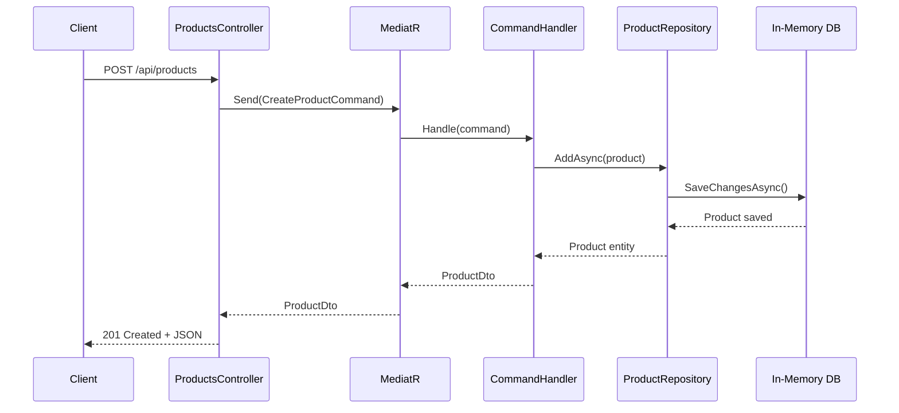

# Walkthrough: Demo Clean Architecture — E-Commerce API

## Tổng quan
Đã xây dựng thành công một dự án mẫu **E-Commerce API** sử dụng kiến trúc **Clean Architecture** với **.NET 10** và **C#**. Dự án minh họa các nguyên lý SOLID và các design pattern phổ biến trong thực tế.

## Cấu trúc dự án

```
d:\clean_architecture\
├── CleanArchitectureDemo.slnx          ← Solution file
│
├── Demo.Domain/                         ← 🟢 LAYER 1: Domain (Core)
│   ├── Entities/
│   │   └── Product.cs                   ← Entity chính
│   ├── Interfaces/
│   │   └── IProductRepository.cs        ← Contract (interface)
│   └── Exceptions/
│       └── NotFoundException.cs         ← Custom exception
│
├── Demo.Application/                    ← 🔵 LAYER 2: Application (Use Cases)
│   ├── Products/
│   │   ├── DTOs/
│   │   │   └── ProductDto.cs            ← Data Transfer Object
│   │   ├── Commands/
│   │   │   ├── CreateProductCommand.cs  ← CQRS: Write
│   │   │   ├── UpdateProductCommand.cs  ← CQRS: Write
│   │   │   └── DeleteProductCommand.cs  ← CQRS: Write
│   │   └── Queries/
│   │       ├── GetProductsQuery.cs      ← CQRS: Read
│   │       └── GetProductByIdQuery.cs   ← CQRS: Read
│   └── DependencyInjection.cs           ← Đăng ký MediatR
│
├── Demo.Infrastructure/                 ← 🟠 LAYER 3: Infrastructure
│   ├── Data/
│   │   └── AppDbContext.cs              ← EF Core DbContext + Seed Data
│   ├── Repositories/
│   │   └── ProductRepository.cs         ← Concrete implementation
│   └── DependencyInjection.cs           ← Đăng ký DB + Repositories
│
└── Demo.API/                            ← 🔴 LAYER 4: Presentation
    ├── Controllers/
    │   └── ProductsController.cs        ← RESTful API endpoints
    ├── Middleware/
    │   └── GlobalExceptionHandlerMiddleware.cs
    └── Program.cs                       ← Composition Root
```

## Các nguyên lý & Design Pattern đã áp dụng

### 1. Dependency Inversion Principle (SOLID - chữ D)
- Interface [IProductRepository](file:///d:/clean_architecture/Demo.Domain/Interfaces/IProductRepository.cs) được định nghĩa ở **Domain** (high-level)
- Implementation [ProductRepository](file:///d:/clean_architecture/Demo.Infrastructure/Repositories/ProductRepository.cs) nằm ở **Infrastructure** (low-level)
- Domain **không biết** về EF Core hay bất kỳ ORM nào

### 2. CQRS Pattern (Command Query Responsibility Segregation)
- **Commands** (ghi dữ liệu): [CreateProductCommand](file:///d:/clean_architecture/Demo.Application/Products/Commands/CreateProductCommand.cs), [UpdateProductCommand](file:///d:/clean_architecture/Demo.Application/Products/Commands/UpdateProductCommand.cs), [DeleteProductCommand](file:///d:/clean_architecture/Demo.Application/Products/Commands/DeleteProductCommand.cs)
- **Queries** (đọc dữ liệu): [GetProductsQuery](file:///d:/clean_architecture/Demo.Application/Products/Queries/GetProductsQuery.cs), [GetProductByIdQuery](file:///d:/clean_architecture/Demo.Application/Products/Queries/GetProductByIdQuery.cs)
- Sử dụng **MediatR** để route Command/Query đến Handler tương ứng

### 3. Thin Controller
- [ProductsController](file:///d:/clean_architecture/Demo.API/Controllers/ProductsController.cs) chỉ nhận request và delegate cho MediatR, **không chứa business logic**

### 4. Composition Root
- [Program.cs](file:///d:/clean_architecture/Demo.API/Program.cs) là nơi **duy nhất** biết về tất cả các layer, kết nối chúng qua DI container

## Luồng dữ liệu (Data Flow)



## Kết quả kiểm tra

| API Endpoint | Method | Kết quả |
|---|---|---|
| `/api/products` | GET | ✅ Trả về 3 sản phẩm seed data |
| `/api/products` | POST | ✅ Tạo sản phẩm mới thành công, trả về 201 Created |
| `/api/products/{id}` | DELETE (ID không tồn tại) | ✅ Trả về 404 Not Found |
| Solution Build | `dotnet build` | ✅ 0 Warnings, 0 Errors |

## Cách chạy

```powershell
& "C:\Program Files\dotnet\dotnet.exe" run --project Demo.API/Demo.API.csproj
```

Sau đó truy cập Swagger UI tại: **http://localhost:5225/swagger**
